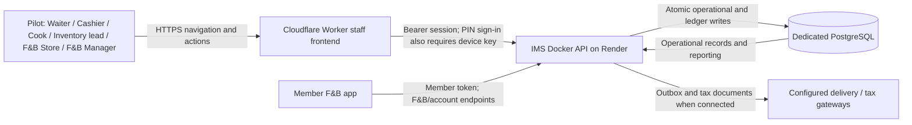
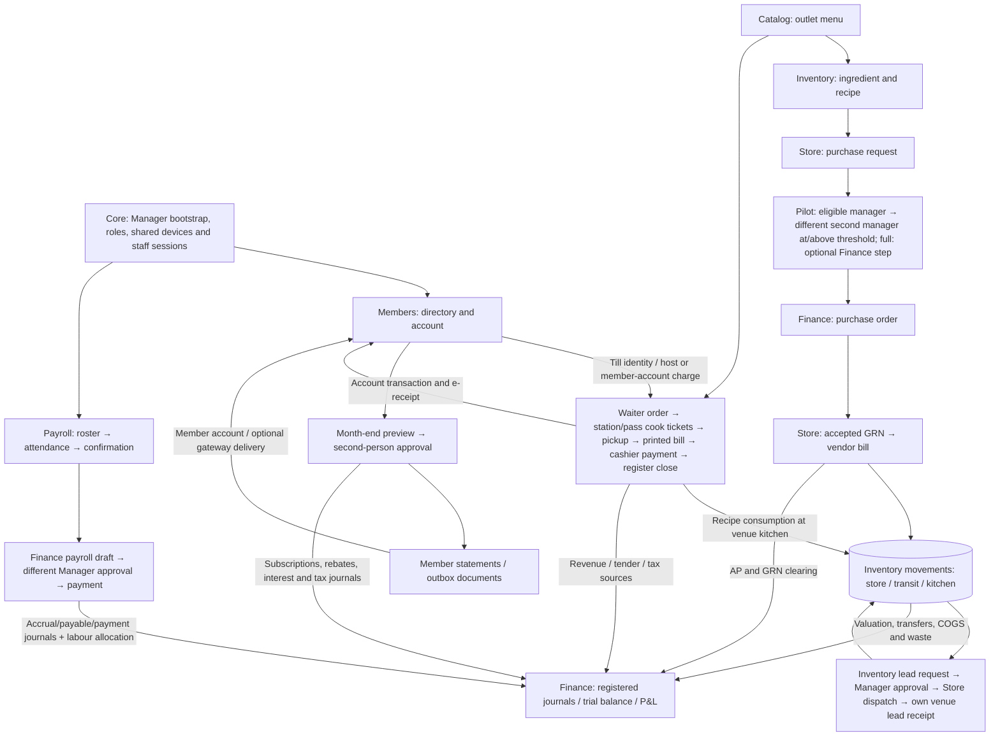

# F&B deployment data flows

The full profile includes F&B, catalog, members/accounts, finance and F&B payroll/shifts. The service pilot
loads catalog, finance, inventory, outlets and shifts; members, payroll and their optional extras are disabled.
Consolidation is opt-in in full and selected in pilot. B1-B6 are implemented in source; B7 is implemented; B8 operational showcase remains
incomplete, and B9/deployment acceptance is pending. Golf, academy and pro shop are absent.

## Context (level 0)

## Operational flow (level 1)

## Accounting and module hand-offs

| Event | Store of record | Reporting contribution |
|---|---|---|
| Accepted ingredient GRN | Finance purchasing + inventory movements | Debit 1210; credit 2150; vendor bill clears 2150 into AP 2100 |
| Dispatch / receipt | Inventory transfer and movement rows | Move 1210 → 1215 → Indoor Cafe 1220 / Rooftop 1230 / Bar 1240 |
| Prepared sale | Outlet order + inventory usage | Food/beverage COGS 5210/5220 against kitchen inventory |
| Member-account sale | Outlet payment + member credit transaction | Member AR 1150 against outlet revenue; no duplicate members sales journal |
| Member receipt | Members receipt and account allocation | Tender/clearing against 1150; suspense goes through 2400 |
| Monthly subscription | Members charge transaction | AR 1150 against membership 4600 and tax 2200 |
| Billing reversal | Linked member reversal; tax credit note | Opposite AR/revenue/tax; original entries retained |
| Approved payroll | Immutable payroll snapshot | Gross expense 6250 against net payable 2220 and deductions 2230 |
| Payroll payment | Paid run with date/account | Clear 2220 into cash 1000 or bank 1010 |

The pilot F&B Manager (`manager`) owns setup, device provisioning and approvals. Venue workers use
PIN sessions tied to a shared device; Manager/store use normal password sessions. Waiters never collect
payment. Station cooks are confined to their station; pass cooks to their venue. Inventory leads confirm
actual receipt only at their assigned kitchen; the store dispatches. An at/above-threshold purchase requires
two different eligible managers, and the pilot's separate Finance decision route returns 404. Full retains
the legacy Finance approval switch and role compatibility. F&B Manager confirms attendance; Finance
prepares/pays payroll only when that feature is enabled. Member authentication cannot read staff endpoints, and staff tokens cannot call member-only endpoints. Notification delivery and statutory tax gateways remain disconnected in the rehearsal unless explicitly configured.

The release smoke checks these balances against source records. DFDs describe the planned testing deployment; they do not establish that live hosting or the mobile build has passed acceptance.

B8 showcase preparation and unresolved prototype relationships are documented in
`backend/docs/SERVICE_B8_REPORT.md` and `SERVICE_B8_SHOWCASE_MAP.md`. The diagrams describe implemented
B1-B6 responsibilities and optional full-profile flows; they do not claim the B7 aggregate/report work,
complete operational showcase seeding, live server/database deployment or physical printing has passed acceptance.

B8 independent foundation reconciles opening stock through inventory/Finance owners. F6 lead count
posting retains count/GL ownership; Discarded creates no movement/journal. Sale references use generic
`sale_references` with selling-module providers.

B7 continuation (2026-10-13): manager venue/payment-hour, discount/void and purchase/transfer reports,
untaxed received-value settlement and owner-provided exception feeds are implemented. Full/pilot evidence
and limitations: `backend/docs/SERVICE_B7_REPORT.md`; shared contract section 8 records exact semantics.
No deployment, public migration/seed or B9 acceptance is inferred from these checks.
