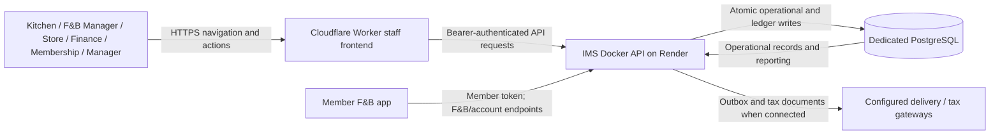
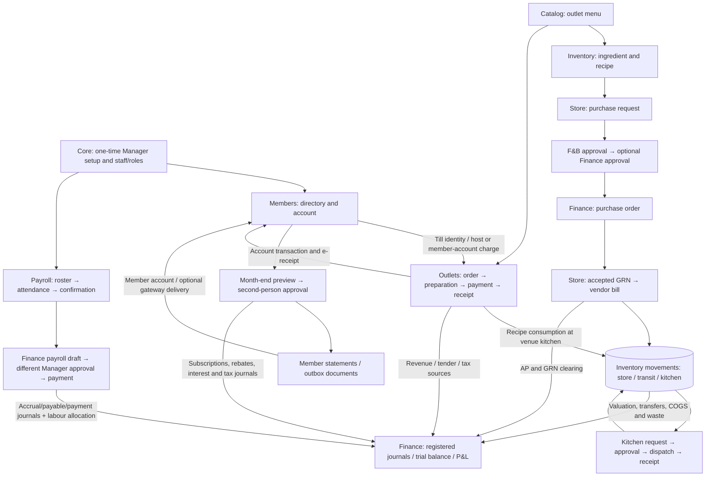

# F&B deployment data flows

This scope includes F&B, catalog, members/accounts, finance and F&B-only payroll/shifts. Golf, academy, pro shop and membership applications are absent.

## Context (level 0)

## Operational flow (level 1)

## Accounting and module hand-offs

| Event | Store of record | Reporting contribution |
|---|---|---|
| Accepted ingredient GRN | Finance purchasing + inventory movements | Debit 1210; credit 2150; vendor bill clears 2150 into AP 2100 |
| Dispatch / receipt | Inventory transfer and movement rows | Move 1210 → 1215 → kitchen 1220 or 1230 |
| Prepared sale | Outlet order + inventory usage | Food/beverage COGS 5210/5220 against kitchen inventory |
| Member-account sale | Outlet payment + member credit transaction | Member AR 1150 against outlet revenue; no duplicate members sales journal |
| Member receipt | Members receipt and account allocation | Tender/clearing against 1150; suspense goes through 2400 |
| Monthly subscription | Members charge transaction | AR 1150 against membership 4600 and tax 2200 |
| Billing reversal | Linked member reversal; tax credit note | Opposite AR/revenue/tax; original entries retained |
| Approved payroll | Immutable payroll snapshot | Gross expense 6250 against net payable 2220 and deductions 2230 |
| Payroll payment | Paid run with date/account | Clear 2220 into cash 1000 or bank 1010 |

The Manager owns setup and final approvals. F&B Manager confirms attendance; Finance prepares/pays payroll. Member authentication cannot read staff endpoints, and staff tokens cannot call member-only endpoints. Notification delivery and statutory tax gateways remain disconnected in the rehearsal unless explicitly configured.

The release smoke checks these balances against source records. DFDs describe the planned testing deployment; they do not establish that live hosting or the mobile build has passed acceptance.
