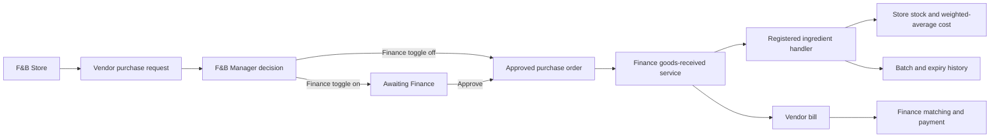

# F&B inventory flow

```mermaid
flowchart LR
    Kitchen[Kitchen staff] -->|Request ingredients| Request[Kitchen request]
    Request -->|Approve quantities| Manager[F&B Manager]
    Manager -->|Approved request| Store[F&B Store]
    Store -->|Dispatch at average cost| Transit[Stock in transit]
    Transit -->|Confirm actual receipt| KitchenStock[Venue kitchen stock]
    Transit -->|Shortfall with reason| Loss[Transit loss]
    KitchenStock -->|Prepared sales or waste| Movement[Costed ingredient movements]
    Loss --> Movement
    Movement --> GL[Registered F&B journal source]
    GL --> Ledger[Finance ledger]
```

Each venue consumes ingredients from its own stock location: Indoor Cafe (and On Course) from the Indoor Cafe Kitchen, Rooftop from the Rooftop Kitchen, Bar from the Bar. Reversals restore the original location. Valuation reconciles to Store 1210, transit 1215, Cafe & Bar 1220 and Rooftop 1230. Waste and transit loss post to 6160; food and beverage consumption post to 5210 and 5220.

The backend depends only on core, members, finance and catalog. It consumes sales-line and labour-cost registries, keeping outlet and payroll dependencies in the direction required by the deployment plan. The frontend adds its Finance approval panel through core's registry; Finance does not import inventory.
