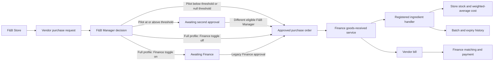

# F&B inventory flow

```mermaid
flowchart LR
    Kitchen[Venue inventory lead; full also retains legacy kitchen staff] -->|Request ingredients| Request[Kitchen request]
    Request -->|Approve quantities| Manager[F&B Manager]
    Manager -->|Approved request| Store[F&B Store]
    Store -->|Dispatch at average cost| Transit[Stock in transit]
    Transit -->|Own venue inventory lead confirms actual receipt| KitchenStock[Venue kitchen stock]
    Transit -->|Shortfall with reason| Loss[Transit loss]
    KitchenStock -->|Prepared sales or waste| Movement[Costed ingredient movements]
    Loss --> Movement
    Movement --> GL[Registered F&B journal source]
    GL --> Ledger[Finance ledger]
```

Each venue consumes ingredients from its own stock location: Indoor Cafe (and On Course) from the Indoor Cafe Kitchen, Rooftop from the Rooftop Kitchen, Bar from the Bar. Reversals restore the original location. Valuation reconciles to Store 1210, transit 1215, Indoor Cafe 1220, Rooftop 1230 and Bar 1240. Waste and transit loss post to 6160; food and beverage consumption post to 5210 and 5220.

The inventory module depends on core, finance and catalog; members is not required. It consumes sales-line and labour-cost registries, keeping outlet and payroll dependencies in the direction required by the deployment plan. The frontend adds its Finance approval panel through core's registry; Finance does not import inventory.

In the consolidated pilot (`roles.consolidated`), inventory leads request, withdraw, count and waste their
own venue stock, and `fnb.receive` authorizes receipt confirmation only at that venue. They may read scoped
stock values and forecast/overview/batches; this grants no club-wide purchasing or Finance reports. Store
staff raise purchases, receive vendor deliveries and dispatch approved kitchen requests; managers decide
requests across venues. The purchase setting is `second_approval_above`, compared in whole paisa at/above
its stored two-decimal threshold. The first approver cannot give the second approval. The old separate
`/fnb/purchase-requests/{id}/finance-decision` returns 404 in the pilot; full preserves the legacy switch.

Inventory owns weighted-average costing and movement/batch provenance. Finance owns POs, GRNs and vendor
bills and calls inventory's registered receiving handler. Transfers carry receipt expiry into request-specific
transit lots, then the receiving kitchen; counts/waste/consumption deplete FIFO lots, with proven sale-reversal
restoration. No expiry is invented for unbatched opening stock or positive count corrections.

B6 source and split verification are in `backend/docs/SERVICE_B6_REPORT.md`. B7 purchase dashboard/transfers,
received-value bill settlement and new exception kinds are now implemented with B7 focused checks. B8
showcase/profile-flow validation is pending; its mapping and prerequisite findings are in
`backend/docs/SERVICE_B8_REPORT.md`. These flows do not establish deployment readiness or B9 sign-off.

## Pre-B7 F6 confirmation (2026-10-13)

Own-location lead may submit counts. Locks serialize count starts/writes. Discard marks only Counting as
Discarded, retains history/lines, changes no stock/GL and permits next count. Snapshot adjustments retain
frozen starting quantities; operations are not paused. Scoped waste returns cost/separate note; enquiry has
average cost and rolling 14-day net sales use for all ingredients. Movement signs come from the selected
location; references use owner registry providers. Requests retain timeline, manager/store notes, requested
value and short reasons. Exact fields/limits: shared contract section 6 and SERVICE_PRE_B7_ANSWERS.md.
B8 opening stock uses movement/GL owners; operational histories remain pending; B7 is implemented.

B7 continuation (2026-10-13): manager venue/payment-hour, discount/void and purchase/transfer reports,
untaxed received-value settlement and owner-provided exception feeds are implemented. Full/pilot evidence
and limitations: `backend/docs/SERVICE_B7_REPORT.md`; shared contract section 8 records exact semantics.
No deployment, public migration/seed or B9 acceptance is inferred from these checks.
